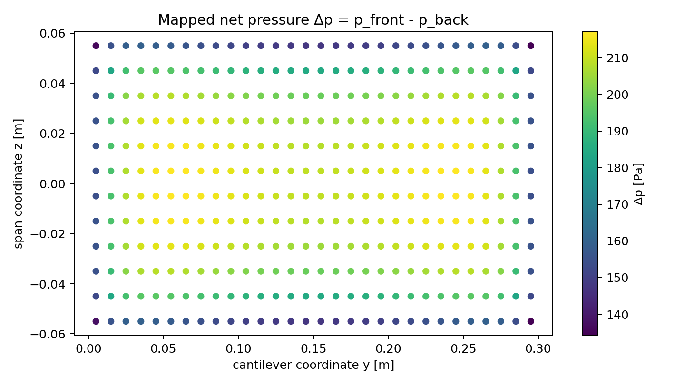
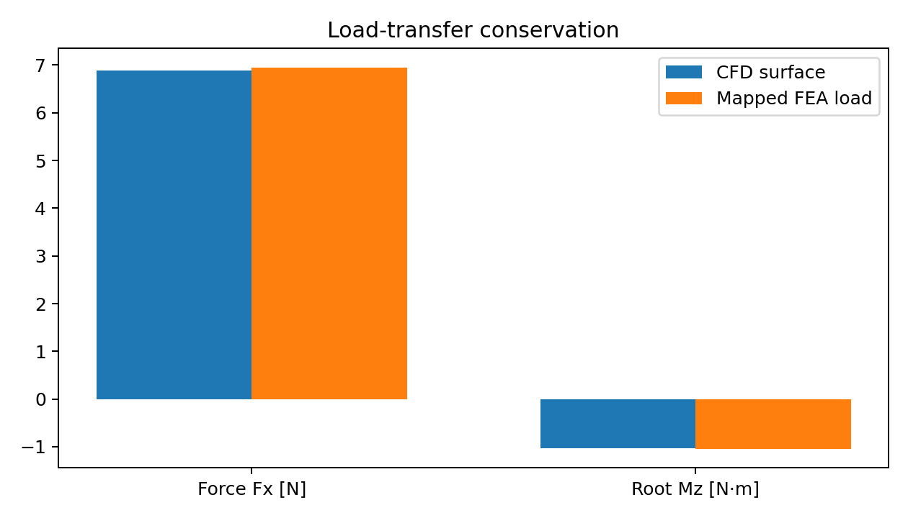
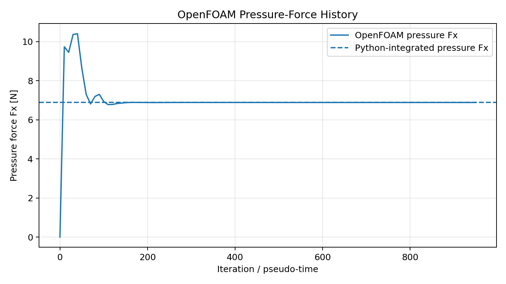
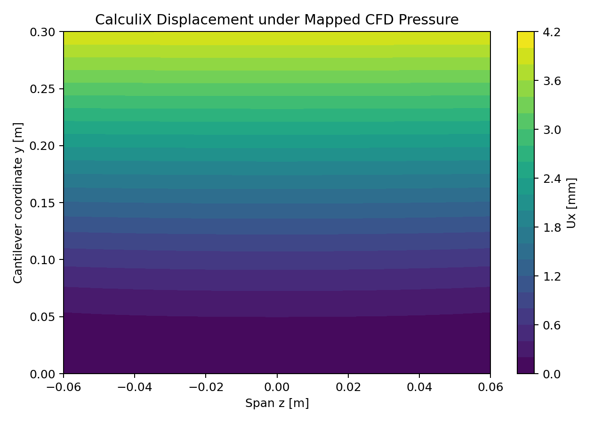
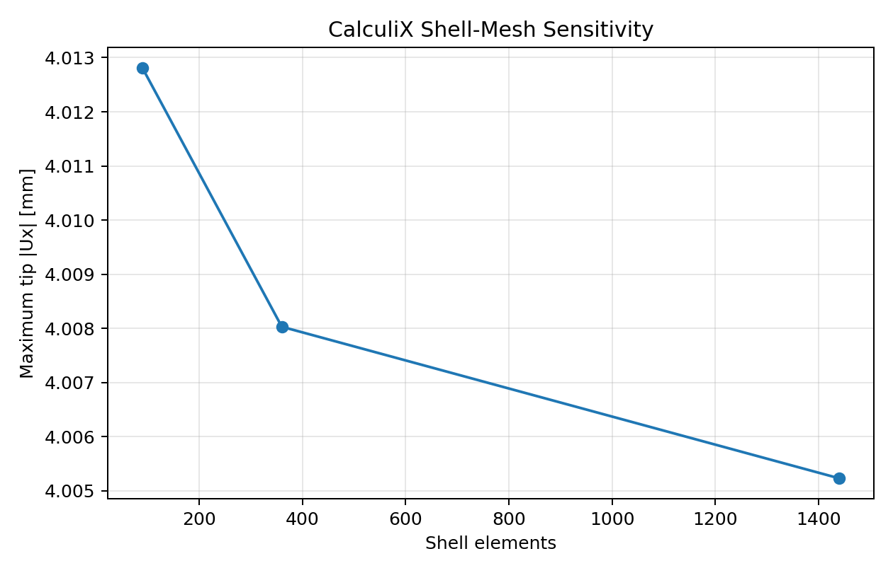

# OpenFOAM -> CalculiX One-Way FSI Demonstrator

[](https://github.com/savbcar/openfoam-calculix-fsi/actions/workflows/ci.yml)

A portfolio-grade, auditable one-way fluid-structure interaction workflow for a thin aluminium cantilever panel in cross-flow:

**OpenFOAM Foundation v13 -> wall pressure -> Python mapping/verification -> CalculiX shell loads -> structural response.**

The project is designed to demonstrate numerical-simulation judgement, solver coupling, load transfer, verification, automation and software quality rather than hide the physics behind a monolithic FSI package.

## What is actually implemented

- OpenFOAM Foundation **v13** external-flow case using the `incompressibleFluid` solver module, steady RANS and k-omega SST.
- Native ASCII OpenFOAM mesh/field parser for `points`, `faces`, `owner`, `boundary` and incompressible `p`.
- Conversion from kinematic pressure to Pa.
- Front/back face classification from OpenFOAM fluid-domain normals.
- Nearest-neighbour and Delaunay piecewise-linear pressure mapping.
- Force **and root-moment** transfer checks.
- Structured S4 CalculiX shell deck generation with element-wise `*DLOAD` pressure.
- Executable Euler-Bernoulli beam FE reference model and closed-form uniform-pressure validation.
- Deterministic synthetic CFD surface data so the transfer stack, plots, report and CI can run without commercial/external solvers.
- pytest, Ruff, GitHub Actions, Docker test environment, engineering notes and interview defence.

<!-- VERIFIED_RESULTS_START -->

## Verified real-solver results

The full baseline workflow was executed locally on WSL using **OpenFOAM Foundation 13** and **CalculiX 2.17**.

| Verification item | Result |
|---|---:|
| OpenFOAM cells | 309,338 |
| `checkMesh` | PASS — Mesh OK |
| max non-orthogonality | 52.58° |
| max skewness | 2.419 |
| panel y+ min / avg / max | 0.244 / 8.825 / 69.430 |
| CFD pressure Fx | 6.888325 N |
| mapped structural Fx | 6.949747 N |
| force-transfer error | **0.892%** |
| CFD root Mz | -1.032953 N·m |
| mapped root Mz | -1.042309 N·m |
| root-moment transfer error | **0.906%** |
| OpenFOAM/Python pressure Fx cross-check | **0.000043%** |
| OpenFOAM/Python pressure Mz cross-check | **0.000093%** |
| CalculiX mean tip Ux | **4.0058 mm** |
| CalculiX max tip Ux | **4.0080 mm** |
| CFD medium→fine Fx change | 1.193% |
| CFD medium→fine Mz change | 0.295% |
| FEA medium→fine tip change | **0.070%** |
| FEA medium→fine peak VM change | 3.353% |
| uniform-load analytical tip | 3.5217 mm |
| uniform-load CalculiX tip | 3.3348 mm |

The baseline transfer satisfies the declared acceptance limits of **2% resultant-force error** and **3% root-moment error**.

The corrected CalculiX pressure direction was independently verified: positive front-to-back pressure produces **+x structural displacement**.

### Real-solver evidence

#### CFD pressure mapped to the shell



#### Force and root-moment conservation



#### OpenFOAM pressure-force history



#### CalculiX structural displacement



#### CalculiX shell-mesh sensitivity



### Numerical interpretation

The medium→fine CFD changes are approximately **1.19% in Fx** and **0.29% in root Mz**.

The CalculiX shell study gives a medium→fine tip-displacement change of only **0.070%**. Peak clamped-edge von-Mises stress remains more mesh sensitive and is therefore not treated as a fully converged design stress.

The panel y+ distribution spans **0.24–69.43**, with mean **8.82**. Near-wall resolution is consequently non-uniform and is retained as an explicit CFD modelling limitation.

This demonstrator intentionally uses **one-way FSI**. Structural deformation is not fed back into the CFD mesh; therefore the project does not claim that deformation-feedback effects have been quantitatively proven negligible.

<!-- VERIFIED_RESULTS_END -->


## Geometry and coordinates

| Quantity | Baseline |
|---|---:|
| panel length L | 0.300 m |
| width b | 0.120 m |
| thickness t | 0.002 m |
| aluminium E | 69 GPa |
| Poisson ratio | 0.33 |
| air speed | 15 m/s |
| density | 1.20 kg/m^3 |
| dynamic viscosity | 1.80e-5 Pa s |

Global convention: flow **+x**, cantilever **+y**, span **z**, shell midsurface `x=0`, root at `y=0`.

## One-way coupling

```text
OpenFOAM-13
   | wall p, geometry, fluid-domain normals
   v
Python extractor + mapper
   | delta-p per shell element
   | force and root-moment conservation
   v
CalculiX S4 shell model
   | U, RF, S
   v
structural response

(no displacement feedback to CFD)
```

One-way coupling is acceptable only if deformation has negligible influence on the fluid loads. A deformed-geometry CFD rerun is the recommended posterior sensitivity check. Large shape changes, flutter, vortex-induced motion or load/deformation feedback require two-way/transient FSI.

## Pressure transfer and sign convention

OpenFOAM boundary normals are outward from the **fluid domain**. For an immersed obstacle they point into the solid. Therefore the pressure force exerted by the fluid on the structure is

`F_i = p_i * A_i * n_fluid,i`.

On this panel the upstream/front normal is approximately +x and downstream/back normal approximately -x, giving `delta_p = p_front - p_back`. The mapper projects both face sets to `(y,z)` on the shell midsurface.

The incompressible OpenFOAM v13 `p` field uses kinematic-pressure units `[0 2 -2 0 0 0 0]`; the extractor converts with `p_Pa = rho * p`.

## Verification strategy

A coupling result is not accepted because contours “look right.” The transfer checks

`epsilon_F = |Fx_map - Fx_CFD| / |Fx_CFD|`

and

`epsilon_M = |Mz_map - Mz_CFD| / |Mz_CFD|`.

Moment conservation matters because the same resultant force can have a different centre of pressure and therefore a different cantilever response.

The structural reference uses the Euler-Bernoulli result for uniform pressure

`delta_tip = 3 p L^4 / (2 E t^3)`

and

`sigma_root = 3 p L^2 / t^2`.

## Quick start: fully executable verification path

```bash
python3 -m venv .venv
source .venv/bin/activate
python -m pip install --upgrade pip
pip install -e '.[dev]'
pytest -q
python -m fsi.cli demo --config config/baseline.yaml --out results/reference
```

The demo creates:

```text
results/reference/
├── cfd_surface.csv
├── mapped_pressure.csv
├── calculix/panel.inp
├── report.json
├── report.md
└── figures/
    ├── pressure_mapping.png
    ├── beam_reference_deflection.png
    ├── conservation.png
    └── mapping_convergence.png
```

These are **synthetic-verification outputs**, clearly labelled as such. They verify the coupling code without falsely claiming that OpenFOAM or CalculiX ran.

The packaged build was executed with **10/10 pytest tests passing**. Its deterministic reference transfer produced **0.0060% force error** and **0.0046% root-moment error**. Those percentages describe only the synthetic mapping/conservation benchmark. See `docs/build_verification.md` for the exact verification boundary.

## Real OpenFOAM 13 -> CalculiX run on WSL

Your local OpenFOAM Foundation v13 installation should expose `foamRun`. If needed:

```bash
source /opt/openfoam13/etc/bashrc
foamVersion
foamRun -help
```

Install the Python package as above, then run:

```bash
bash scripts/run_real_pipeline.sh
```

The script runs the supplied OpenFOAM case, extracts the `panel` patch from the latest time, maps pressure, writes `results/real/calculix/panel.inp`, and runs `ccx` if it exists on `PATH`.

Manual equivalent:

```bash
cd cases/openfoam13/panel
./Allrun
cd ../../..
python -m fsi.cli extract-openfoam \
  --case cases/openfoam13/panel \
  --patch panel --time latest --density 1.20 \
  --out results/real/cfd_surface.csv
python -m fsi.cli couple \
  --config config/baseline.yaml \
  --surface results/real/cfd_surface.csv \
  --out results/real/calculix
cd results/real/calculix
ccx -i panel
```

### Important real-run gates

Before using real numbers on a CV, complete `docs/real_solver_checklist.md`. The repository also includes executable three-level campaigns:

```bash
python scripts/run_cfd_convergence.py
python scripts/run_fea_convergence.py --surface results/real/cfd_surface.csv
```

These generate CSV summaries for CFD and shell-mesh sensitivity instead of relying on hand-recorded values.

## Repository structure

```text
openfoam-calculix-fsi/
├── cases/openfoam13/panel/     # complete OF13 case
├── config/baseline.yaml
├── docs/
│   ├── build_verification.md
│   ├── engineering_notes.md
│   ├── interview_defence.md
│   ├── real_solver_checklist.md
│   └── verification_matrix.md
├── src/fsi/
│   ├── openfoam.py             # native ASCII case parser
│   ├── mapping.py
│   ├── conservation.py
│   ├── calculix.py
│   ├── structural.py           # independent beam-FE reference
│   ├── synthetic.py
│   ├── plots.py
│   └── pipeline.py
├── tests/
├── .github/workflows/ci.yml
├── Dockerfile
└── README.md
```

## Docker

Docker is intentionally used for the Python QA environment, not to mask a host OpenFOAM installation:

```bash
docker build -t openfoam-calculix-fsi-test .
docker run --rm openfoam-calculix-fsi-test
```

Your existing OpenFOAM 10 Docker image is not used by this project because the checked-in CFD case targets **Foundation OpenFOAM 13**, matching your local `foamVersion`.

## Design decisions worth defending

1. **Simple plate, not a wing:** analytical structural checks remain possible while the CFD->FEA mesh transfer is still real.
2. **Pressure difference, not front pressure only:** both sides contribute to net structural traction.
3. **No silent conservation correction:** interpolation error is measured; results are not “fixed” without disclosure.
4. **Force + moment verification:** checks both load magnitude and centre of pressure.
5. **Independent solver validation:** Python coupling tests do not depend on OpenFOAM/CalculiX being installed.
6. **Native OpenFOAM parser:** avoids a hidden mesh-conversion dependency and makes the data path auditable.
7. **S4 production deck + beam reference:** the simple beam model validates scale/trends; it is not misrepresented as the shell solution.

## Limitations

- Pressure-only transfer; viscous shear is not mapped.
- Baseline CFD is steady RANS. A bluff-plate wake may require transient time averaging.
- Panel y+ was measured during the real OpenFOAM campaign; its broad distribution is reported explicitly as a near-wall modelling limitation.
- The native extractor assumes ASCII fields and a wall pressure represented by the owner-cell value (appropriate for the supplied zero-gradient wall p condition).
- No two-way displacement feedback or moving mesh.
- Root stress in a clamped shell can be mesh/singularity sensitive; compare converged section/reaction quantities and stresses away from the exact constraint edge.
- CalculiX shell pressure direction was sign-checked on the real solver run; the configurable sign convention remains documented for reproducibility.

## CV bullet

> Developed and validated an auditable OpenFOAM 13→CalculiX one-way CFD/FEA coupling workflow in Python, transferring non-uniform aerodynamic pressure to S4 shell loads with 0.89% resultant-force and 0.91% root-moment transfer error on the baseline mesh; quantified CFD/FEA mesh sensitivity and supported the workflow with analytical structural checks, Docker, automated tests and multi-version CI.

## References / solver compatibility

The case targets OpenFOAM Foundation v13's modular `incompressibleFluid` workflow (`foamRun`) and standard `physicalProperties` / `momentumTransport` dictionaries. CalculiX uses S4 shell elements and `*DLOAD` pressure. See the official OpenFOAM Foundation v13 and CalculiX documentation for solver-specific details.

## License

MIT.
